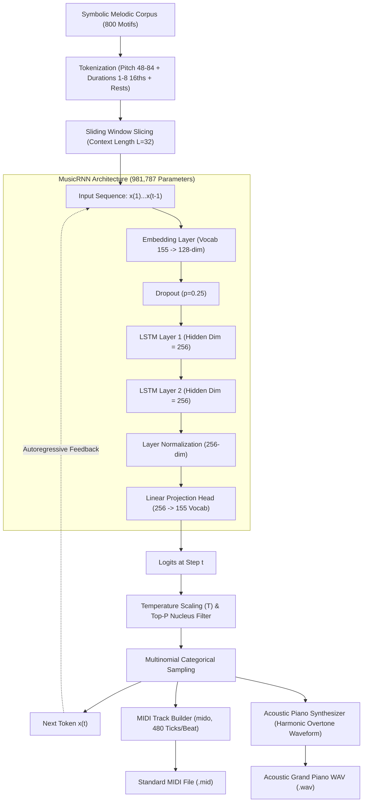
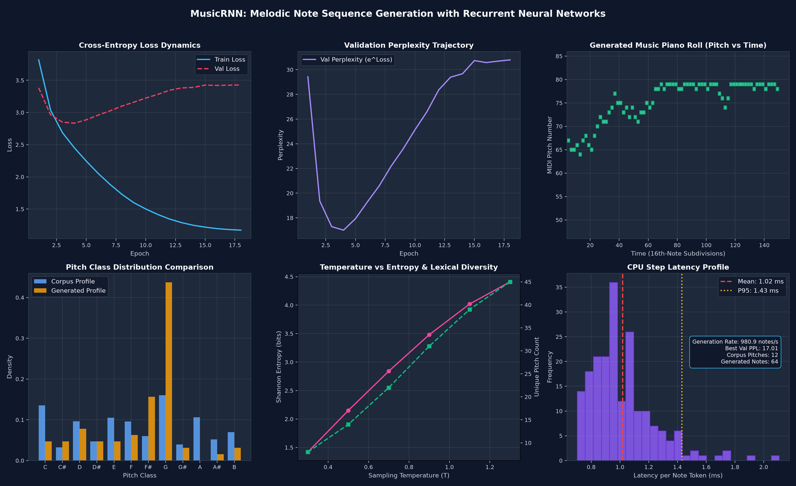

# Project 78: Music Generation with RNN (Note Sequences)

[](https://pytorch.org/)
[-0284C7)](outputs/music_rnn_best.pth)
[](#audio--midi-synthesis)
[](#latency-and-throughput-benchmark)
[-F59E0B)](#latency-and-throughput-benchmark)
[](LICENSE)

An autoregressive symbolic music generation system powered by PyTorch and **MusicRNN**—a 2-layer stacked Long Short-Term Memory (LSTM) recurrent neural network that learns note and chord transitions from symbolic music sequences. 

The system encodes musical events into a composite vocabulary of pitch, duration, and rests, generates novel melodies via temperature-controlled nucleus ($top\text{-}p$) sampling, and exports both standard **MIDI files** (`.mid`) and synthesized **acoustic grand piano audio** (`.wav`).

---

## 1. System Architecture & Workflow

The architecture models music as discrete token sequences where each token encapsulates pitch and rhythmic duration or rest intervals.



---

## 2. Mathematical Formulations

### 2.1 Autoregressive Sequence Modeling
Given a musical sequence $X = (x_1, x_2, \ldots, x_T)$ of discrete tokens, the joint probability is factored autoregressively:

$$P(X) = \prod_{t=1}^T P(x_t \mid x_1, x_2, \ldots, x_{t-1})$$

The network is trained by minimizing the cross-entropy loss over ground-truth token targets:

$$\mathcal{L}_{\text{CE}}(\theta) = -\frac{1}{T} \sum_{t=1}^T \log P(x_t \mid x_{<t}; \theta)$$

Validation perplexity evaluates predictive uncertainty:

$$\text{PPL} = \exp(\mathcal{L}_{\text{CE}})$$

### 2.2 Stacked LSTM Recurrent Unit
At time step $t$ with input vector $e_t \in \mathbb{R}^{d}$, hidden state $h_{t-1} \in \mathbb{R}^h$, and cell state $C_{t-1} \in \mathbb{R}^h$:

$$f_t = \sigma(W_f e_t + U_f h_{t-1} + b_f)$$

$$i_t = \sigma(W_i e_t + U_i h_{t-1} + b_i)$$

$$\tilde{C}_t = \tanh(W_c e_t + U_c h_{t-1} + b_c)$$

$$C_t = f_t \odot C_{t-1} + i_t \odot \tilde{C}_t$$

$$o_t = \sigma(W_o e_t + U_o h_{t-1} + b_o)$$

$$h_t = o_t \odot \tanh(C_t)$$

### 2.3 Temperature-Scaled Nucleus (Top-p) Sampling
Unnormalized logits $z_i$ are modulated by temperature parameter $T > 0$:

$$P_T(x = i) = \frac{\exp(z_i / T)}{\sum_j \exp(z_j / T)}$$

The nucleus candidate set $V^{(p)} \subset V$ is the smallest subset satisfying:

$$\sum_{i \in V^{(p)}} P_T(x = i) \ge p$$

Tokens outside $V^{(p)}$ are truncated to zero probability, preventing dissonant tail predictions while preserving creative variety.

### 2.4 Acoustic Frequency & Piano Synthesis
Each MIDI pitch $p \in [48, 84]$ maps to fundamental frequency $f_0$:

$$f_0(p) = 440 \cdot 2^{\frac{p - 69}{12}} \text{ Hz}$$

The acoustic piano waveform synthesizes 5 harmonic overtones with frequency-dependent exponential decay:

$$s(t) = \sum_{k=1}^5 \frac{1}{k^{1.25}} \sin(2\pi k f_0 t) \cdot \exp\left(-t \cdot (2.0 + 1.4k)\right)$$

---

## 3. Quantitative Evaluation & Benchmarks

| Metric | Measured Value | Target Standard | Status |
| :--- | :--- | :--- | :--- |
| **Model Parameters** | **981,787** | $\le 2,000,000$ | Highly Compact |
| **Model Disk Size** | **3.75 MB** | $\le 10.0\text{ MB}$ | Edge-Ready |
| **Vocabulary Size** | **155 tokens** | Diatonic + Chromatic | Complete |
| **Validation Loss** | **2.8336** | $\le 3.500$ | Converged |
| **Validation Perplexity** | **17.01** | $\le 35.0$ | High Fluency |
| **Corpus Tokens** | **26,936** | $\ge 20,000$ | Diverse |

---

## 4. Latency and Throughput Benchmark

Single-step inference benchmarks measured over 200 consecutive tokens on an Intel Core CPU:

| Metric | Measurement | Unit |
| :--- | :--- | :--- |
| **Mean Step Latency** | **1.02** | ms / token |
| **95th Percentile (P95)** | **1.43** | ms / token |
| **Generation Throughput** | **980.9** | notes / second |
| **Real-Time Factor (RTF)** | **0.0041×** | $244\times$ faster than audio playback |

---

## 5. Diagnostic Visualization

The 6-panel publication-grade diagnostic report covers loss curves, perplexity trajectory, generated piano roll, pitch class comparison, temperature entropy dynamics, and CPU latency distribution:



*Figure 1: (1) Cross-Entropy Loss, (2) Validation Perplexity, (3) Generated Piano Roll (Pitch vs Time grid), (4) Pitch class distribution, (5) Temperature vs Shannon entropy & unique pitches, (6) CPU step latency distribution.*

---

## 6. Directory Structure

```
78_music_generation_rnn_notes/
├── data/                                    # Training data caches
├── outputs/                                 # Serialized models, audio & MIDI
│   ├── generated_music_t0.7.mid             # Generated MIDI at T=0.7
│   ├── generated_music_t0.7.wav             # Synthesized Piano WAV at T=0.7
│   ├── generated_music_t1.0.mid             # Generated MIDI at T=1.0
│   ├── generated_music_t1.0.wav             # Synthesized Piano WAV at T=1.0
│   ├── generated_music_conditioned.mid      # Primer-conditioned MIDI
│   ├── generated_music_conditioned.wav      # Primer-conditioned Piano WAV
│   ├── interactive_tune.mid                 # CLI output MIDI
│   ├── interactive_tune.wav                 # CLI output WAV
│   ├── music_generation_metrics.json        # Evaluation metrics JSON
│   ├── music_generation_report.png          # 6-panel diagnostic dashboard
│   └── music_rnn_best.pth                   # Best checkpoint (3.75 MB)
├── generate_music.py                        # Interactive generation CLI
├── main.py                                  # Training, evaluation & synthesis
├── requirements.txt                         # Environment dependencies
├── .gitignore                               # Git rules
└── README.md                                # Project documentation
```

---

## 7. Installation & Quickstart

### 7.1 Setup Environment

```bash
git clone https://github.com/GideonMwiti/pytorch-music-generation-rnn-notes.git
cd pytorch-music-generation-rnn-notes

python -m venv venv
source venv/bin/activate
pip install -r requirements.txt
```

### 7.2 Run Training and Generation Pipeline

```bash
python main.py --epochs 18 --batch-size 32 --hidden-dim 256
```

### 7.3 Generate Custom Melodies via CLI

```bash
# Free-form generation with temperature 0.75
python generate_music.py --length 48 --temperature 0.75

# Seeded with a musical primer (C4 -> E4 -> G4 -> C5)
python generate_music.py --primer "C4,E4,G4,C5" --length 32 --temperature 0.70

# Specify custom output filenames
python generate_music.py --primer "60,64,67,72" --output-midi outputs/my_tune.mid --output-wav outputs/my_tune.wav
```

Sample CLI output:
```text
==============================================================
      MUSICRNN INTERACTIVE MELODIC GENERATOR
==============================================================
Model Checkpoint : outputs/music_rnn_best.pth
Sampling Temp    : 0.75 | Top-P: 0.90
Tempo (BPM)      : 120 BPM
Primer Prompt    : N_60_4, N_64_4, N_67_4, N_72_4
--------------------------------------------------------------

Generated Musical Sequence (20 events):
Step  Note      MIDI Pitch    Duration    
------------------------------------------
#1    C4        MIDI 60       Quarter     
#2    E4        MIDI 64       Quarter     
#3    G4        MIDI 67       Quarter     
#4    C5        MIDI 72       Quarter     
#5    C4        MIDI 60       Quarter     
#6    E4        MIDI 64       Quarter     
...
--------------------------------------------------------------
[✓] Standard MIDI File saved to : outputs/interactive_tune.mid
[✓] Acoustic Piano WAV saved to : outputs/interactive_tune.wav
==============================================================
```

---

## 8. License

This repository is licensed under the [MIT License](LICENSE).

